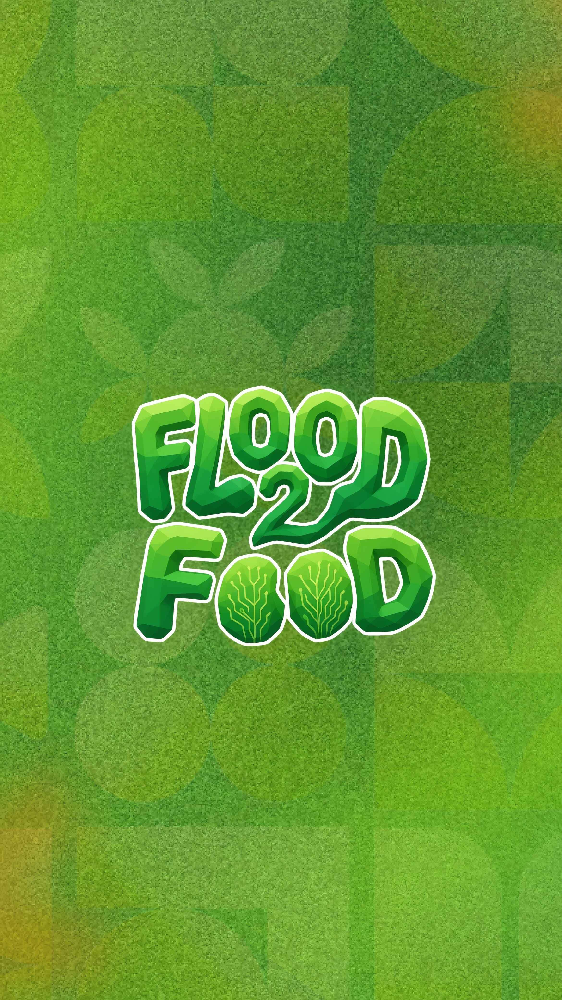
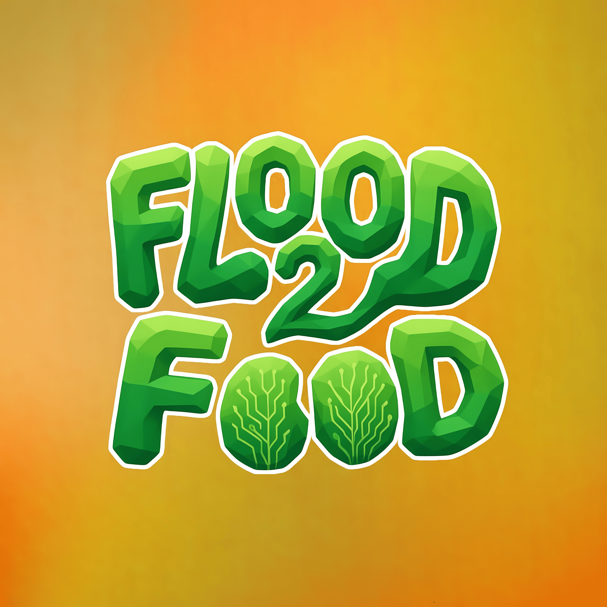

<div align="center">
  
  
  
  # 🌱 Flood2Food
  **Sistem Cerdas Pemulihan Lahan Sawah Pascabanjir Berbasis IoT & Gamifikasi AI**
  
  [](https://flutter.dev/)
  [](https://www.arduino.cc/)
  []()
  []()
</div>

<br/>

> **Flood2Food** adalah terobosan *Precision Agriculture* (Agrikultur Presisi) untuk menyelamatkan lahan padi pascabanjir. Sistem ini mendeteksi 7 parameter vital tanah secara *real-time* via sensor Modbus RS485, mengirimkannya sejauh belasan kilometer via LoRa, dan menyajikannya ke *smartphone* petani. Lebih dari sekadar dasbor, aplikasi ini menggunakan **Kecerdasan Buatan (AI)** untuk mendiagnosis tanah dan memberikan misi gamifikasi harian yang terukur dan aplikatif! 🚀

---

## ✨ Fitur Unggulan

<table>
  <tr>
    <td align="center">📡<br/><b>Industrial IoT Telemetry</b></td>
    <td align="center">⚡<br/><b>Quantum BLE Sync</b></td>
    <td align="center">🧠<br/><b>AI-Powered Gamification</b></td>
    <td align="center">🛡️<br/><b>Bulletproof Offline AI</b></td>
  </tr>
  <tr>
    <td>Transmisi jarak jauh LoRa dari sawah ke Gateway dengan toleransi <i>disconnect</i> otomatis (Deep Sleep).</td>
    <td>Algoritma <i>Smart Chunking</i> khusus untuk menembakkan ribuan baris log CSV ke HP dalam 2 detik tanpa <i>crash</i>.</td>
    <td>Alih-alih panduan kaku, AI Gemini akan meracik "Misi Pemulihan Harian" sesuai penyakit tanah secara spesifik.</td>
    <td>Tidak ada kuota internet? Sistem <i>Local Fallback</i> akan memberikan instruksi agronomi darurat dari <i>database</i> internal.</td>
  </tr>
</table>

---

## 🏗️ Anatomi Sistem (Source Code)

Repositori ini memuat *Full-Stack Code* dari seluruh ekosistem **Flood2Food**:

### 1. 📍 Sensor Node (`/node`)
Perangkat ujung (*Edge Device*) yang ditancapkan langsung ke petak sawah.
* **Sensor:** NPK 7-in-1 (Nitrogen, Fosfor, Kalium, pH, EC, Suhu, Kelembaban).
* **Mikrokontroler:** ESP32.
* **Protokol Utama:** Modbus RTU (RS485) & LoRa (Transmitter).

### 2. 🗼 Gateway Logger (`/gateway`)
Stasiun pengumpul data yang diletakkan di saung/pos pantau pertanian.
* **Komponen:** ESP32 + Modul SD Card + LoRa (Receiver) + LCD I2C.
* **Peran:** Menyimpan data *real-time* ke format CSV dan menembakkannya (Broadcast) ke *smartphone* petani melalui Bluetooth Low Energy (NimBLE).

### 3. 📱 Aplikasi Flutter (`/flood2food`)
Aplikasi seluler (Android/iOS) modern sebagai pusat kendali (*Companion App*).
* **Desain:** Modern, responsif, dan *user-friendly* untuk petani.
* **Fungsi:** Visualisasi grafik NPK, riwayat CSV interaktif, sinkronisasi *seamless*, dan Gamifikasi AI Cerdas.
* *(Note: Folder ini berisi seluruh mentahan / source-code aplikasi sebelum di-compile ke APK)*

---

## 🛠️ Instalasi & Penggunaan

### 💻 A. Flash Firmware (Hardware)
1. Buka file `node/node.ino` dan `gateway/gateway.ino` menggunakan **Arduino IDE**.
2. Pastikan *Library* wajib ini terinstal di PC Anda:
   - `LoRa` by Sandeep Mistry
   - `NimBLE-Arduino` by h2zero *(Wajib untuk Gateway!)*
   - `ArduinoJson` by Benoit Blanchon
   - `ModbusMaster`
3. Sesuaikan PIN pada konfigurasi jika Anda menggunakan *custom board*. *Compile* dan *Upload*!

### 📱 B. Build Aplikasi (Flutter)
1. Buka *Terminal*, masuk ke direktori aplikasi:
   ```bash
   cd flood2food
   ```
2. Tarik semua *dependencies*:
   ```bash
   flutter pub get
   ```
3. (Opsional) Pasang API Key Gemini AI Anda di file `.env` root aplikasi:
   ```env
   AI_API_KEY=KODE_API_GEMINI_ANDA
   AI_MODEL=gemini-1.5-flash
   ```
4. Jalankan (Run) ke emulator/HP, atau *Build* menjadi APK:
   ```bash
   flutter build apk --split-per-abi
   ```

---
<div align="center">
  <p>💡 <i>Dipersembahkan oleh Tim PKM-KC untuk ketahanan pangan nasional.</i></p>
  
</div>
