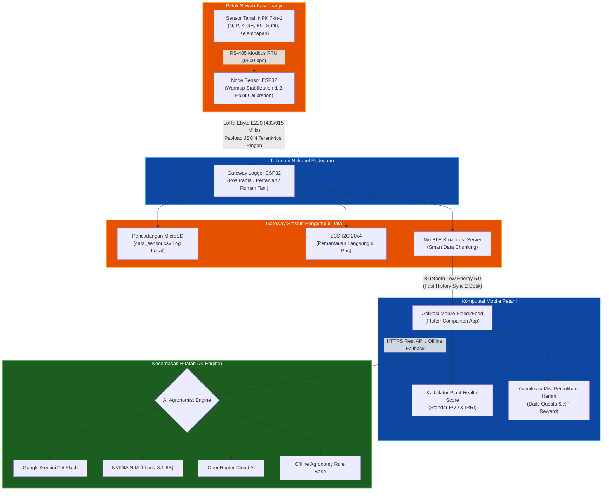
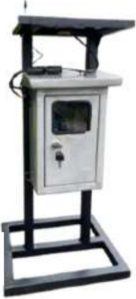

<div align="center">

  # 🌱 Flood2Food (PKM-KC USU 2026)
  ### *Sistem Cerdas Pemulihan Lahan Sawah Pascabanjir Berbasis Industrial IoT, Long-Range Telemetry, dan Gamifikasi Rekomendasi Agronomi AI*

  [-3DDC84?style=for-the-badge&logo=android&logoColor=white)](https://github.com/aziqi/Flood2Food/releases/tag/v1.0.0)
  [](https://website-f2f-next-js.vercel.app/)
  []()
  []()
  [](https://flutter.dev/)
  [](https://www.espressif.com/)
  []()
  [](LICENSE)

  <p align="center">
    <b>Inovasi Kolaboratif Mahasiswa Lintas Disiplin Ilmu Universitas Sumatera Utara</b><br/>
    <i>Didanai secara resmi oleh Kementerian Pendidikan Tinggi, Sains, dan Teknologi Republik Indonesia (Kemendiktisaintek RI) melalui Direktorat Jenderal Pembelajaran dan Kemahasiswaan (Belmawa) - SIMBELMAWA 2026.</i>
  </p>

</div>

---

## 📌 Ringkasan Eksekutif & Urgensi Riset

Banjir bandang dan genangan luapan air di kawasan sentra pertanian padi Indonesia sering kali meninggalkan kerusakan hara parah (*catastrophic nutrient washing*). Sawah pascabanjir mengalami fenomena denitrifikasi Nitrogen drastis, pemadatan tanah anaerobik, akumulasi pirit/toksisitas ion besi terlarut ($Fe^{2+}$), penurunan tajam $pH$ (*acid sulfate soils*), serta salinisasi akibat residu garam terlarut (*Electrical Conductivity / EC spike*). Pendekatan konvensional petani yang menyamaratakan pemupukan kimia susulan justru memicu *fertilizer burn* dan pemborosan modal tani.

**Flood2Food** hadir sebagai terobosan sistem *cyber-physical* agrikultur presisi (*precision agriculture*) terintegrasi yang menggabungkan:
1. **Edge Sensing Node 7-in-1**: Pengukuran parameter fisik-kimiawi tanah *real-time* via sensor tanah industri berstandar Modbus RTU RS-485.
2. **Sub-GHz Long-Range Telemetry**: Transmisi nirkabel LoRa (*Chirp Spread Spectrum*) berdaya rendah yang sanggup menembus topografi sawah dan pepohonan hingga belasan kilometer tanpa ketergantungan sinyal seluler GSM.
3. **Gateway Data Collector**: Stasiun pos pantau tani dengan pencadangan log ganda (*microSD FAT32*), hardware interrupt anti-bouncing, dan komunikasi lokal ultra-cepat via *Bluetooth Low Energy* (NimBLE).
4. **Mobile Companion Application**: Aplikasi cerdas berbasis Flutter 3 yang memetakan skor kesehatan tanaman (*Plant Health Score*) berbobot ilmiah (FAO & IRRI) dan mentransformasikan arahan agronomis rumit menjadi **Misi Gamifikasi Harian** yang interaktif, terukur, dan adaptif bagi petani.

---

## 🗺️ Topologi Arsitektur Sistem

Alur transmisi data dari petak sawah hingga ke genggaman petani dan komputasi awan diilustrasikan dalam diagram berikut:



---

## 📸 Antarmuka Aplikasi Mobile (*Companion App*)

Aplikasi mobile **Flood2Food** dirancang dengan filosofi *clean editorial design*, kontras tipografi tajam, serta ergonomi tinggi agar ramah digunakan oleh petani di lapangan maupun peneliti laboratorium.

<table>
  <tr>
    <td align="center" width="20%">
      <br/>
      <sub><b>01. Layar Pembuka</b></sub>
    </td>
    <td align="center" width="20%">
      <br/>
      <sub><b>02. Dasbor Metrik Real-time</b></sub>
    </td>
    <td align="center" width="20%">
      <br/>
      <sub><b>03. Misi Harian Berhadiah XP</b></sub>
    </td>
    <td align="center" width="20%">
      <br/>
      <sub><b>04. Konsultasi AI Agronomist</b></sub>
    </td>
    <td align="center" width="20%">
      <br/>
      <sub><b>05. Profil Petani & Lahan</b></sub>
    </td>
  </tr>
  <tr>
    <td align="center" width="20%">
      <br/>
      <sub><b>06. Histori Log & Ekspor CSV</b></sub>
    </td>
    <td align="center" width="20%">
      <br/>
      <sub><b>07. Pemindaian Cepat BLE</b></sub>
    </td>
    <td align="center" width="20%">
      <br/>
      <sub><b>08. Pengaturan Perangkat</b></sub>
    </td>
    <td align="center" width="20%">
      <br/>
      <sub><b>09. Manajemen Model AI</b></sub>
    </td>
    <td align="center" width="20%">
      <br/>
      <sub><b>10. Kalibrasi Spasial</b></sub>
    </td>
  </tr>
</table>

---

## ⚡ Keunggulan Teknologi & Inovasi Rekayasa

### 1. Perangkat Keras (*Hardware & Firmware*)
<table>
  <tr>
    <td width="35%" align="center">
      <br/>
      <b>Unit Node Sensor Ujung (Field Edge Device)</b>
    </td>
    <td width="65%">
      <ul>
        <li><b>Sensor 7-in-1 Modbus RTU RS-485</b>: Mengukur Nitrogen (N), Fosfor (P), Kalium (K), derajat keasaman ($pH$), Konduktivitas Elektrik ($EC$ dalam satuan $\mu S/cm$), Suhu Tanah (°C), dan Volumetric Water Content ($VWC$ / Kelembapan %).</li>
        <li><b>Warm-Up Stabilization Filter</b>: Algoritma filter khusus yang mengambil 5 sampel berturut-turut pada saat terbangun, membuang 2 sampel awal (fase instabilitas kapasitif sensor), dan merata-ratakan 3 sampel sisanya.</li>
        <li><b>Model Kalibrasi 2-Titik (Air Anchor + Gain)</b>: Mencegah nilai melenceng saat sensor dicabut dengan mereferensikan pembacaan udara murni sebagai titik nol mutlak via perintah <code>CALIB_AIR</code>.</li>
        <li><b>Deteksi Sensor Terangkat (Air Drop Fallback)</b>: Otomatis menetralkan nilai menjadi 0 jika sensor berada di udara bebas ($rawPH < 5$) demi integritas data ilmiah.</li>
      </ul>
    </td>
  </tr>
  <tr>
    <td width="35%" align="center">
      <br/>
      <b>Unit Gateway & Pos Pantau Tani</b>
    </td>
    <td width="65%">
      <ul>
        <li><b>Hardware Interrupt Debounce (Zero Ghost-Touch)</b>: Tombol kontrol fisik LCD terhubung langsung ke interrupt pin prosesor (<code>isrTombol</code>) dengan filter latensi $20\text{ ms}$, menghilangkan pembacaan ganda saat ditekan.</li>
        <li><b>Dual Storage Logging</b>: Merekam setiap paket telemetri masuk ke memori SPI Flash dan kartu MicroSD lokal dalam format CSV baku dengan pembersihan retensi berkala otomatis.</li>
        <li><b>Silent Wake & Smart Force Read</b>: Ketika petani menyinkronkan data via BLE, Gateway merespons sekejap mata dari kartu SD lokal dan memicu sinyal LoRa bangun senyap (*wake pulse*) agar Node memperbarui data terikini.</li>
      </ul>
    </td>
  </tr>
</table>

### 2. Standar Agronomi & Pembobotan *Plant Health Score*
Algoritma evaluasi kesehatan tanah pada Flood2Food tidak menggunakan nilai asumtif sembarangan, melainkan mengacu pada literatur baku agrikultur internasional (**FAO / IRRI Dobermann & Fairhurst 2000 / UC Davis**):

| Parameter Tanah | Satuan | Rentang Defisiensi / Kritis | Rentang Optimum (Ideal) | Rentang Berlebih / Toksik | Bobot Skor |
|---|:---:|:---:|:---:|:---:|:---:|
| **Nitrogen ($N$)** | $mg/kg$ | $< 20$ *(klorosis daun)* | $20 - 50$ | $> 80 - 100$ *(risiko lodging)* | **25%** |
| **Fosfor ($P$)** | $mg/kg$ | $< 6$ *(pertumbuhan kerdil)* | $10 - 25$ | $> 40 - 50$ | **20%** |
| **Kalium ($K$)** | $mg/kg$ | $< 60$ *(tepi daun terbakar)* | $100 - 200$ | $> 300 - 400$ | **20%** |
| **Derajat Keasaman ($pH$)** | - | $< 5.0$ *(sulfat masam / toksik Fe)* | $5.5 - 7.0$ | $> 7.5$ *(alkalin)* | **15%** |
| **Salinitas ($EC$)** | $\mu S/cm$ | $> 1000$ *(tekanan osmotik parah)* | $< 200$ *(aman)* | $400 - 1000$ *(stres salinitas)* | **10%** |
| **Kelembapan ($VWC$)** | $\%$ | $< 20\%$ *(kekeringan)* | $30\% - 45\%$ | $> 55\%$ *(anaerobik jenuh)* | **10%** |

---

## 📂 Struktur Direktori Repositori

```text
Flood2Food/
├── .gitignore                      # Konfigurasi pengabaian berkas repositori utama
├── README.md                       # Dokumentasi utama proyek Flood2Food
├── node/                           # [Firmware C++] Node Sensor Ujung (ESP32)
│   └── node.ino                    # Logika baca RS485, warm-up filter, kalibrasi & transmiter LoRa
├── gateway/                        # [Firmware C++] Stasiun Pengumpul Gateway (ESP32)
│   └── gateway.ino                 # Receiver LoRa, MicroSD logger, interrupt LCD, server NimBLE
└── flood2food/                     # [Mobile App] Aplikasi Seluler Pendamping Petani (Flutter 3)
    ├── pubspec.yaml                # Manajemen dependensi pustaka Dart & aset
    ├── android/                    # Konfigurasi Android native & Google Services
    ├── assets/                     # Aset logo, banner, dan dataset NPK lapangan
    ├── doc/                        # Dokumentasi visual & screenshot aplikasi
    │   ├── assets/                 # Foto perangkat keras dan foto tim riset
    │   └── screenshots/            # 10 tangkapan layar antarmuka aplikasi
    └── lib/                        # Kode sumber arsitektur aplikasi Flutter
        ├── models/                 # Model data sensor, standar agronomi & gamifikasi
        ├── screens/                # Layar UI (Dasbor, Chat AI, Misi Harian, Log, Kalibrasi)
        ├── services/               # Layanan BLE, integrasi AI (Gemini/NIM), dan ekspor CSV
        └── widgets/                # Komponen grafik interaktif dan kartu metrik tanah
```

---

## 🚀 Panduan Instalasi & Menjalankan Proyek

### A. Persiapan Perangkat Keras (*Firmware Flashing*)
1. Pasang aplikasi **Arduino IDE** (versi 2.x ke atas disarankan).
2. Tambahkan URL board manager ESP32 pada *Preferences*:
   `https://raw.githubusercontent.com/espressif/arduino-esp32/gh-pages/package_esp32_index.json`
3. Pasang pustaka pendukung via *Library Manager*:
   - `NimBLE-Arduino` oleh h2zero
   - `ArduinoJson` oleh Benoit Blanchon (v6 atau v7)
   - `ModbusMaster` oleh 4-20ma
   - `LoRa` oleh Sandeep Mistry
4. Buka berkas `node/node.ino` untuk Node Sensor, dan `gateway/gateway.ino` untuk Gateway.
5. Pilih board **ESP32 Dev Module**, hubungkan kabel USB-C/Micro-USB, lalu lakukan **Upload**.

### B. Menjalankan Aplikasi Mobile (*Flutter Development*)
1. Pastikan Anda telah menginstal **Flutter SDK** (versi 3.22+ direkomendasikan) dan **Android Studio**.
2. Masuk ke direktori aplikasi:
   ```bash
   cd flood2food
   ```
3. Unduh seluruh dependensi paket:
   ```bash
   flutter pub get
   ```
4. Hubungkan *smartphone* Android dengan mode *USB Debugging* aktif, lalu jalankan aplikasi:
   ```bash
   flutter run
   ```
5. Untuk membuat berkas distribusi APK produksi:
   ```bash
   flutter build apk --release --split-per-abi
   ```

---

## 👥 Tim Peneliti & Pengembang (PKM-KC USU 2026)

Inovasi **Flood2Food** lahir dari kolaborasi lintas disiplin ilmu mahasiswa dan dosen pembimbing **Universitas Sumatera Utara**:

<div align="center">
  
</div>

<br/>

### Dosen Pembimbing
<div align="center">

| Nama & Gelar | NIDN | Fakultas / Unit | Bidang Kepakaran |
|---|:---:|:---:|---|
| **Dr. Ir. Zikri Noer, S.Si., M.Si.** | `0021078403` | Fakultas Vokasi, Universitas Sumatera Utara | *Instrumentasi Fisika, Sensorika & Metrologi Agrikultur* |

</div>

### Mahasiswa Peneliti
| No | Nama Peneliti | NIM | Program Studi & Fakultas | Peran dalam Tim | Fokus Riset & Kontribusi |
|:---:|---|:---:|---|:---:|---|
| 1 | **Syakirah Fathanah** | `230805053` | S-1 Biologi, FMIPA '23 | **Ketua Tim** | Formulasi Biologi Pemulihan Tanah, Desain Eksperimen Lapangan & Manajemen Riset |
| 2 | **Athallah Muhammad Maajid** | `251401040` | S-1 Ilmu Komputer, Fasilkom-TI '25 | **Software Lead** | Arsitektur Mobile Flutter, Sinkronisasi Protokol BLE, Integrasi Engine AI & Gamifikasi |
| 3 | **Aziqi Arifian Dova** | `241757008` | D-4 Rekayasa Instrumentasi, F. Vokasi '24 | **Hardware Lead** | Rekayasa Node Sensor 7-in-1, Telemetri LoRa, Power Management Circuit & Kalibrasi Metrologi |
| 4 | **M. Ghozi Muzakki** | `230305048` | S-1 Teknologi Pangan, FP '23 | **Agronomi & Mutu** | Validasi Lapangan Petak Sawah, Dinamika Unsur Hara Padi & Evaluasi Mutu Pascapanen |
| 5 | **Isrok Tenggar Martua** | `240805093` | S-1 Biologi, FMIPA '24 | **Bio-Remediasi** | Formulasi Kultur Mikroorganisme, Pengujian Dekontaminasi Ion Beracun & Efektivitas Hayati |

---

## 🏛️ Mitra & Dukungan Resmi

Program riset dan implementasi teknologi ini didanai dan didukung secara penuh oleh:
- **Kementerian Pendidikan Tinggi, Sains, dan Teknologi Republik Indonesia (Kemendiktisaintek RI)**
- **Direktorat Jenderal Pembelajaran dan Kemahasiswaan (Belmawa)**
- **SIMBELMAWA (Sistem Informasi Pembelajaran dan Kemahasiswaan)**
- **Universitas Sumatera Utara (USU)**
- **PKM Center Universitas Sumatera Utara**
- **Pekan Ilmiah Mahasiswa Nasional (PIMNAS 39)**
- **Laboratorium Penguji BPTP Sumatera Utara** *(Terakreditasi KAN LP-863-IDN)*

---

## Lisensi

Hak Cipta (c) 2026 Aziqi Arifian Dova (Flood2Food Team). Seluruh hak cipta dilindungi undang-undang. Kode sumber ini dipublikasikan hanya untuk keperluan portofolio, penilaian akademik, dan pengujian aplikasi. Dilarang mengambil, memodifikasi, atau memperjualbelikan kode ini.

<div align="center">
  <sub>Dibangun dengan dedikasi tinggi demi ketahanan pangan dan kedaulatan petani Indonesia. 🇮🇩</sub>
</div>
